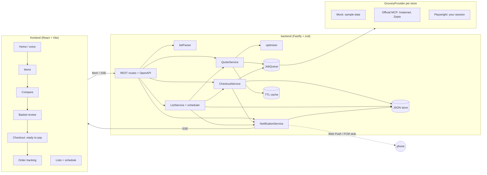
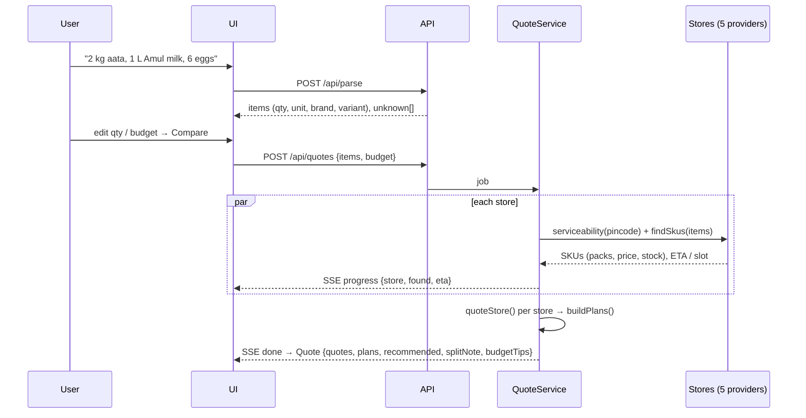

# Architecture: Akaya Grocery Agent

## Overview



The provider interface has **no** pay, checkout or place-order method. The MCP adapter additionally blocks any tool whose name
matches checkout/pay/confirm/place/coupon, even if it is allowlisted by mistake (unit-tested).

## Quote flow



Store data (SKUs, ETA) is cached per pincode, store set, hour and item list. Plans are always rebuilt from the current items,
so item ids stay consistent.

## Optimizer

1. **packCombo:** cheapest way to cover the quantity with up to two pack sizes (e.g. 4 kg → 1 × 5 kg if cheaper than 4 × 1 kg),
   with a small penalty for heavy over-buying.
2. **linesFor:** preferred brand/variant first; otherwise another brand ("Amul not available at Zepto; picked Nandini"); otherwise a
   related item from the catalogue's `subs`. Up to four alternatives are kept per line for the substitution sheet.
3. **quoteStore:** lines + store fee rules (delivery above/below free threshold, handling, small-cart, platform).
4. **buildPlans:**
   - *Cheapest* and *Fastest*: best single store covering everything (fewest missing items first).
   - *Split*: every 2–3 store subset, each item assigned to its cheapest store, then local search moves items between stores
     while the total (fees included) drops. Offered only if it saves ≥ ₹20 or covers items no single store has.
   - *Best overall*: `total + 0.35 × ETA minutes + 25 × extra stores + 120 × missing + 12 × substitutions`.
5. **budgetTips:** cheapest swaps from the alternatives until the plan fits the budget.

## Checkout: fill, notify, hand-off (never pay)

```mermaid
stateDiagram-v2
  [*] --> filling: POST /api/checkouts (server re-prices overrides)
  filling --> ready: provider.fillCart() + verified total
  ready --> expired: PAYMENT_WINDOW_MINUTES passed
  ready --> handed_off: user taps "Confirm & pay in X" → deep link / website
  handed_off --> paid_by_user: user taps "I've paid" (userConfirmed: true)
  ready --> cancelled
  handed_off --> cancelled
  paid_by_user --> [*]: order tracking
  note right of ready: notification "Cart ready: confirm & pay ₹X"
```

`paid_by_user` is the user's own confirmation. With a partner integration, an order webhook or order-history call should confirm it.

## Schedules

`ListService` runs every `SCHEDULE_TICK_MS`. A due list is quoted with its strategy; with `autoFill` its cart is filled and a
ready-to-pay notification is sent, otherwise a "list ready" notification links to the comparison. `nextRun()` computes the
next weekday/time **in IST** (UTC+5:30) and is unit-tested across the IST date boundary.

## Production swaps

| Here (single process) | Production |
|---|---|
| `TtlCache` (memory) | Redis (`REDIS_URL`) |
| `JobQueue` (memory, concurrency N) | BullMQ / Cloud Tasks; per-store concurrency + backoff |
| JSON file store | Postgres (users, lists, checkouts, orders, notifications, push subs) |
| `x-user-id` header (demo user) | Real auth (Akaya account), per-user OAuth tokens for store MCPs in a secrets vault |
| Push stub | `web-push` with VAPID keys; FCM HTTP v1 for the Android/iOS app |
| Mock tracking | Store order-status APIs / MCP `track_order` / webhooks |
