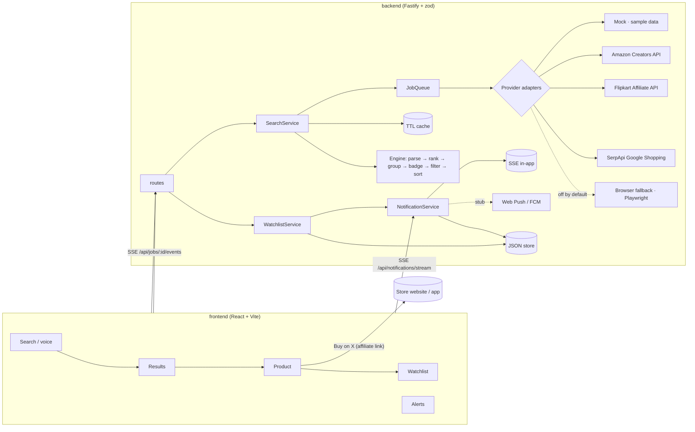
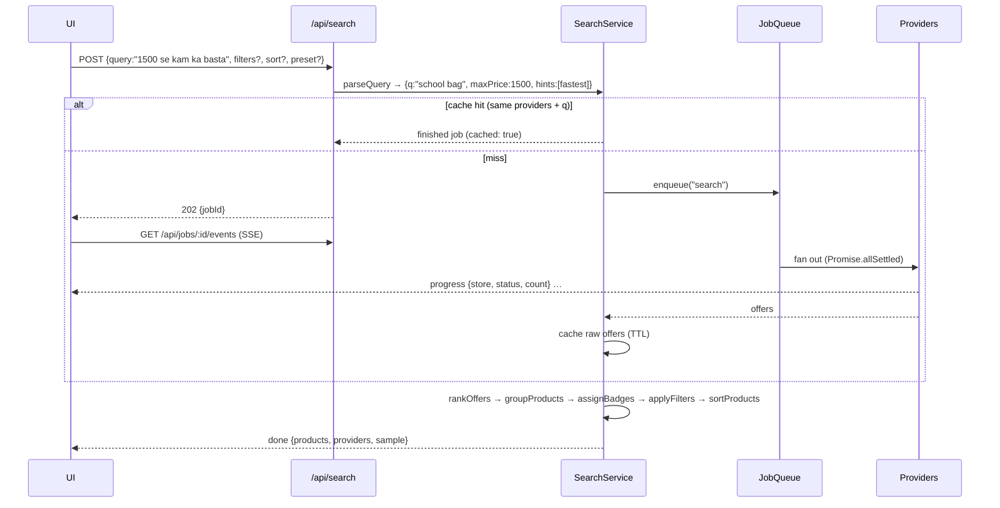
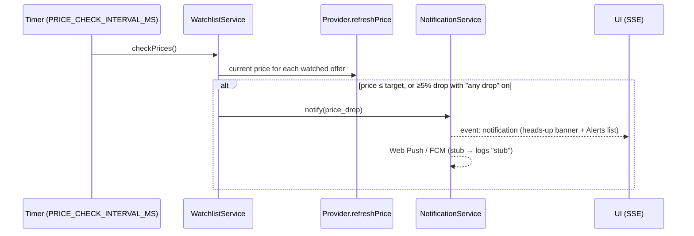

# Architecture: Akaya Shopping Agent

## Overview

The agent **never** places orders: the only path to a purchase is the user opening the store link.

## Search flow

Raw offers are cached rather than ranked results, so changing filters, sort or preset re-ranks
instantly without calling paid APIs again.

## Ranking

For each offer (weights per preset, Balanced shown):

| Signal | Normalisation | Balanced weight |
| --- | --- | --- |
| Price | `(minPrice / price)^0.7` across all offers | 0.30 |
| Rating | Bayesian average (prior 3.8, C = 200), mapped 3–5 → 0–1 | 0.24 |
| Delivery | 1 day → 1.0, 10 days → 0 | 0.18 |
| Seller trust | seller rating, fulfilled-by-store, years active | 0.16 |
| Review volume | log10(count) / log10(max count) | 0.12 |
| Fake-review risk | penalty `0.3 × risk` | − |
| Out of stock | penalty 0.5 | − |

Products are grouped across stores by product key. A product's score is its best offer's score plus
a small multi-store bonus. Badges go to in-stock offers that aren't high fake-review risk.

## Price alerts

## Production swaps

| Demo component | Production replacement |
| --- | --- |
| `JobQueue` (in-process) | BullMQ on Redis (`REDIS_URL`), same `enqueue / get / on(jobId)` surface |
| `TtlCache` | Redis with TTL |
| `JsonDb` file | Postgres (users, watch_items, price_snapshots, notifications, push_subscriptions) |
| `x-user-id` header | real auth (Akaya session / JWT) |
| Push stubs | `web-push` with VAPID keys; FCM HTTP v1 with a service account |
| Mock price history | nightly price snapshots for watched + popular products |
